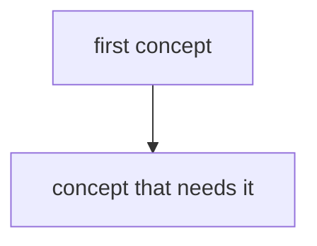

<!-- template -->
# Map: game-theory-financial-markets

## Concepts

Rows are in teaching order. Prerequisites are concept ids, comma-separated, or `-`.
Status is one of: unseen, introduced, practised, recalled-later, can-explain.

| id | concept | prerequisites | status |
|---|---|---|---|
| first-concept | First concept | - | unseen |

## Open questions and debates

- A question the field hasn't settled, with who holds which view.
