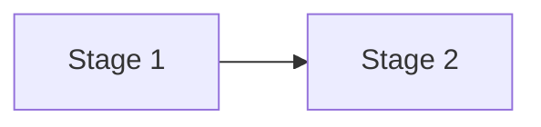

# Path: {topic}

Depth: orient | use | master. Total time: about N hours.

## Stage 1: name

- Goal: what you can do after this stage.
- Concepts: concept ids from map.md.
- Read: [s1] chapter or section, with page or section numbers. Why this one.
- Time: about N hours.
- Checkpoint: one question you should be able to answer without notes.

## Skip unless

- [sN] what it covers, and when it becomes worth reading.
