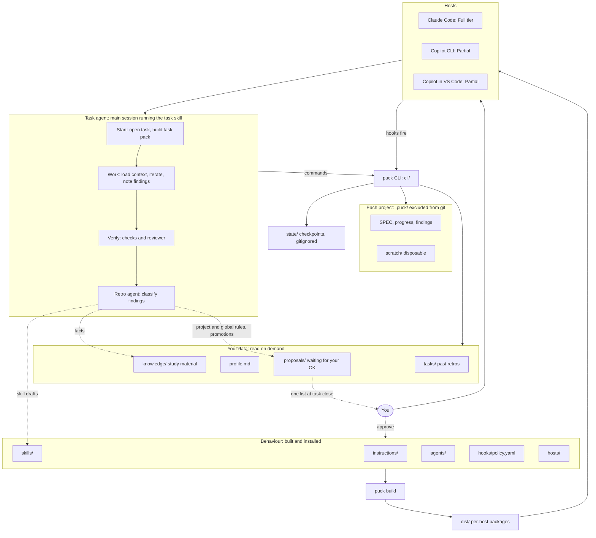

# Puck: a layer in front of any agent harness

## Context

Puck is a layer in front of every agent harness. Its purpose is to optimise all the context an LLM has and to improve its tools. Claude Code and Copilot are the first adapters, not the scope, and any harness should be able to gain one.

You use it for two jobs: learning topics you care about (search plus good learning skills) and helping you code and plan systems. You asked for deep research first and named context management as the main open question.

**Decision: build a layer, not a new agent loop.** The research supports your hunch. Skills, MCP tools and AGENTS.md travel between hosts. Loops, UIs, auth and sandboxes are expensive to rebuild and are already good. Original work should go where hosts are weakest: task continuity, learner state, verification and capturing what each task teaches.

**What that gives up:** Puck doesn't own the agent loop, system prompt, prompt caching or compaction. It can only influence them through hooks, and how much varies by host. Exact behaviour across hosts is not a goal.

**Decision: no model proxy yet.** Extension points can add context and tools, but can't trim what the harness already sends. Only a proxy on model traffic can do that, at the cost of API-key-only use. Puck builds on extension points first and records context use from milestone 2 (`puck metrics`). A proxy gets added only if those numbers justify it.

## Research findings that drive the design

Evidence quality varies. Much of it is preprints, vendor reports or small samples, and it is mostly about coding.

| Finding | Design consequence |
|---|---|
| No open harness in an 11-system source study retrieves code with embeddings (Barbaste 2026) | Start with grep; no vector database |
| Summaries kept 16% of recurring details, mechanical anchors 79% (Compact-Bench, Oct 2026) | Capture anchors ourselves |
| Models under-use optional retrieval (Vercel: skills uninvoked in 56% of cases; Fan: recall tool unused in 36 of 64 settings) | Critical context is injected or in instruction files, not left to the model to fetch |
| Generated AGENTS.md files lowered success and raised cost 20%+ (Gloaguen) | Hand-written, under 100 lines, non-obvious facts only |
| Iterated LLM memory updates "round off" facts (secondhand) | Standing-context changes must be reviewable diffs |
| A concrete external checklist passed 10/10, generic self-check 5/10 (Xue, small sample) | Verification by checklist, in a separate agent or script |
| Unstructured AI raised practice scores but lowered later exam scores (Bastani); delegating scored 24-39%, conceptual inquiry 65-86% (Shen & Tamkin, small cells) | Attempt first; explicit learn vs build modes |
| Pure refusal drove students away (Khanmigo); prompts alone didn't hold tutoring order (Kestin) | Friction is adjustable; real tests happen outside the chat |
| Citation accuracy 39-77% with link validity above 94%; accuracy fell as tool calls rose (arXiv 2605.06635) | Claim-level check, not more fan-out |
| FSRS beats SM-2 for 99.6% of users (project-run benchmark); LLM flashcards 36-52% unusable | py-fsrs, with human approval of every card |
| No controlled evidence that SDD frameworks or TDD rituals pay off | One-page SPEC.md with acceptance checks |
| MCP Sampling and Roots deprecated (2026-07-28); MCP can't inject context or intercept tools | MCP is for tools only |
| Hooks have no shared standard; VS Code warns that sharing a file doesn't make hooks compatible | Normalised hook entry point, per-host shims, capability tiers |
| Subagents get a fresh window and return only a summary; some built-in ones skip CLAUDE.md | Agent docs carry their own rules and a fixed return format |

## Architecture

Solid lines are build and runtime paths. Dotted lines are the capture loop.



- **Generator:** turns the behaviour folders into per-host packages using a small `HostConfig` per host (frontmatter allowlist, capability-to-tool map, paths, tier), the gstack model. Written in-house, because two hosts don't justify adopting rulesync or dotagents.
- **Packaging:** a Claude Code plugin is the main target, since it carries skills, agents, hooks and MCP. Milestone 1 tests whether Copilot's legacy `.claude-plugin/plugin.json` support works, which would shrink the generator.
- **Core and CLI:** one Python library. Hooks and skills call the CLI, which needs no extra host support. A thin stdio MCP server arrives only when a model-facing tool is needed. It will use explicit parameters and no Sampling, Roots or server-initiated requests.

**Language: Python with uv.** It's the most used language in your projects, the MCP SDK is Tier 1, py-fsrs exists, and uv is installed.

**Hosts and tiers.** Copilot CLI and Copilot in VS Code are two separate hosts, tested separately. Codex and others wait until these work.

| Host | Tier | Why |
|---|---|---|
| Claude Code | Full | `PreCompact`, compact `SessionStart` and blocking `Stop` exist |
| Copilot CLI | Partial until proven | No documented compact `sessionStart` or post-compact event; `preCompact` output is ignored |
| Copilot in VS Code | Partial | Hooks are in Preview and ignore matchers |
| Others | Content-only | Skills and instructions only |

### Repo layout

```
puck/
  AGENTS.md
  pyproject.toml

  # Behaviour: built and installed into hosts
  instructions/global.md
  skills/{task,plan,review,research,kb,learn}/
  agents/{researcher,claim-checker,reviewer,retro}.md
  hooks/policy.yaml
  hosts/{claude,copilot-cli,copilot-vscode}.yaml
  hosts/refs/*-tools.md
  templates/          # skill, agent, SPEC, retro templates

  # Code: the puck CLI
  cli/
    main.py  hooks.py  build.py  lint.py
    tasks.py  context.py  skills.py  anchors.py  scratch.py  kb.py  learn.py

  # Your data: never installed, read on demand
  knowledge/          # study material: raw/, wiki/, cards, index.md, log.md; created in milestone 3
  profile.md          # hand-written, capped
  proposals/          # changes waiting for your OK
  tasks/              # non-project tasks, and every finished task's retro

  # Generated or local: gitignored
  state/              # checkpoints
  dist/               # per-host packages

  tests/
  docs/research/      # the research reports
```

**Behaviour and data stay separate.** Behaviour changes how the agent acts in every session, so it's linted, evaluated and gated. Data only informs a task when it's read, so wiki pages can land automatically.

**`knowledge/` holds study material only:** sources, wiki notes and flashcards for topics you're learning. It can be opened as an Obsidian vault. Facts tied to a procedure live in that skill's `references/`, so they load with the skill and stay out of the skill listing.

`cli/` is the only Python folder, so there's no `src/` nesting. `pyproject.toml` exposes it through `puck = "cli.main:main"`, and `uv tool install --editable .` puts `puck` on your PATH.

**Everything personal lives in this one repo.** The installer sets `PUCK_HOME` to it, so hooks and skills can find it from any project. Your existing vault at `~/Documents/StudyNotes/TheTruth` is left untouched, and notes can be imported later. The repo stays local by default, and any remote must be private.

Active work in a code project lives in `<project>/.puck/`, which is added to `.git/info/exclude`, so it never touches the project's commits or `.gitignore`. Keeping it inside the project means scratch code can import project modules and writes stay inside the host's working directory. The finished retro is copied to `tasks/`, so past tasks stay searchable across projects.

## Execution flow

**The task agent owns the whole workflow, and you never run a retro yourself.** The task agent is the main session following the `task` skill, not a subagent. The main session keeps the conversation with you and can spawn workers, which a nested subagent may not be able to do on every host.

```
 1. start ──── size the request; open a task; build the task pack
 2. work ───── load what's needed; iterate in scratch; note findings
 3. verify ─── run the acceptance checks; reviewer for non-trivial changes
 4. retro ──── automatic: fresh retro agent classifies findings
 5. capture ── safe outputs are written; the rest are proposed to you in one list
```

1. **Start.** Quick questions and one-line fixes don't open a task. Otherwise `puck task start "<goal>" --type build|learn|research|plan` creates the task folder and builds a task pack: relevant skills, KB pages, past retros and pending proposals, found with ripgrep over names, descriptions and headings. The pack holds paths and one-line summaries, not content, capped at 2,000 characters.
2. **Work.** The agent reads what the pack points to and hands off to `plan`, `learn`, `research` or `kb` as needed. Anything non-obvious goes through `puck note`.
3. **Verify.** Each acceptance check needs its command and output. Non-trivial changes also get the `reviewer` agent.
4. **Retro.** The task agent spawns the `retro` agent with the task folder. A fresh context keeps this out of the main window and stops the working session grading itself. With no findings, it writes one line and stops, so small tasks cost little. The always-on rules say to do this. A stop hook acts as a safety net if the agent forgets.
5. **Capture.** What happens depends on the risk of each change:

| Finding | Destination | How it lands |
|---|---|---|
| One-off | Task retro | Automatic |
| Fact about a topic | `knowledge/` wiki page with source | Automatic, uncommitted; never loaded as rules |
| Repeatable procedure, or a fact tied to one | New skill, or a change to a skill or its `references/` | Automatic as a `draft`, which no session loads |
| Fact about a project | That project's AGENTS.md or an ADR | Proposal |
| Rule for all your work | `instructions/global.md`, checked against its cap | Proposal |
| Promoting a skill to `active` | `puck skill promote` | Proposal |

Proposals close the task as one short list in the same conversation, and you answer in plain language. Anything unanswered stays in `proposals/` and appears in the next task pack. Standing instructions still can't change without you, because that's where unreviewed writes do the most harm. Everything else stays out of your way.

## Parallel work

Puck supports parallelism at two levels. The host runs the agents, and Puck keeps them from colliding.

| Level | Example | Who runs it | Isolation |
|---|---|---|---|
| Workers inside a task | Three researchers, or a reviewer beside the task agent | Host subagents | Read-only workers share the checkout; writers each get a worktree |
| Several tasks at once | Auth fix in one terminal, a study session in another, on any mix of hosts | You open each session | Each coding task gets its own git worktree |

**Sessions and tasks**
- There's no global "active task". `state/sessions/<session-id>.json` binds each session to its task, so hooks, checkpoints and `close-guard` only touch that session's work.
- `puck task start --worktree` creates a branch and worktree for the task, and you open a session there. Tasks on separate topics or read-only work don't need one.
- `puck task list` shows every open task with its host, session, worktree and step status.
- Each task runs its own retro and raises its own proposals. Puck never merges branches; merging stays your decision.

**Shared files**
- `PUCK_HOME` can receive writes from several sessions, and all of them go through the CLI, which takes a file lock.
- Proposals, retros and drafts are one file each with unique names, so they can't overwrite each other.
- A change to an existing skill is stored as a patch in `proposals/`, never written straight into `skills/`. Two tasks can both suggest changes, and the second one surfaces any conflict at review.
- Appends to `findings.md`, `LOG.md`, checkpoints and `log.md` are locked, because subagent hooks can fire at the same time. `index.md` is regenerated rather than edited.
- Git commits in this repo are serialised by the same lock.

**Limits:** fan-out defaults to at most 5 workers per task, because each one costs about as much as a full agent. Worker counts are capped in the skill, and nested fan-out is not used.

## Primitive specifications

### Which primitive to use

Ask these in order. The first yes wins.

| Question | Primitive |
|---|---|
| Must it happen every time, whatever the model decides? | Hook or CLI code |
| Can a program compute it exactly? | CLI command or skill script |
| Is it a short rule true in nearly every session? | Instruction |
| Is it a repeatable procedure needed only sometimes? | Skill |
| Is it noisy, or does it need fresh eyes or fewer tools? | Agent |
| Is it a fact needed only for one procedure? | Skill `references/` |
| Is it study material on a topic you're learning? | Knowledge |
| Does it only matter to this task? | Task file |
| Is it an experiment or draft? | Scratch |

Slash commands are not a separate primitive. A skill with `invocation: user` covers them on every host.

`puck lint` enforces everything below, using `templates/` as the starting point for each type.

### Instruction doc

Sources are `instructions/global.md` (all work) and each project's AGENTS.md. Generated into each host's user-level instruction file.

- Under 100 lines and within the always-on budget, with the task and retro rule at the top.
- Hand-written, or changed only through an approved proposal.
- Each line must pass one test: would the agent get this wrong without it?
- No codebase overviews, no style rules a linter can check, no generated summaries.
- Project AGENTS.md holds build and test commands, unusual conventions, and pointers into `docs/`.

### Skill

```
skills/<name>/
  SKILL.md        # entry point, loaded on use
  references/     # read only when SKILL.md says so; one level deep
  scripts/        # deterministic helpers
  assets/         # templates
  evals.yaml      # moved to the eval location by build; never installed
```

```markdown
---
name: review
description: >-
  Review a change against its SPEC.md and report defects with evidence.
  Use when a non-trivial change is ready. Not for style or planning.
metadata:
  version: "3"
  status: active            # draft | active | retired
  invocation: model         # model | user
  requires: "subagents"     # shell, subagents, web
  origin: "2026-11-03-auth-fix"
  last_evaluated: "2026-11-05"
---
## Procedure
1. ...

## Output
...

## Done when
- [ ] ...

## If something fails
...

## Host differences
Read references/<host>-tools.md if a named capability is unclear.
```

- `description` says what it does, when to use it and when not to. It's the only part loaded on every turn, so it's written for matching and kept under 1,024 characters.
- Only standard frontmatter is used. Puck's extras sit in `metadata` as strings, and `build` converts them to host fields such as `disable-model-invocation`.
- The procedure comes first, because compaction can keep only the start of a skill.
- Bodies target 150 lines, with a hard limit of 500. Longer material moves to `references/`.
- Text names capabilities and `puck` commands, never host tool names or variables like `${CLAUDE_SKILL_DIR}`.
- "Done when" is a concrete checklist, since generic self-checks did much worse.

**Lifecycle:** `draft` (excluded from builds) → `active` → `retired` (excluded, kept in git). `skills/` is the only source of truth; `dist/` and installed copies are never edited. New skills get one should-trigger and one should-not-trigger eval case from the task that produced them. The retro prefers updating an existing skill over adding a near-duplicate. Web text is summarised, never copied in.

`puck skill try <name>` loads a draft into one session through a temporary plugin (`claude --plugin-dir`) without installing it. `puck skill promote <name>` runs lint and evals, builds, installs and commits, so approving a promotion approves that commit.

### Agent doc

```markdown
---
name: reviewer
description: Fresh-context review of a change against its SPEC.md.
tools: [read, search, shell-read]   # capabilities, mapped per host
model: strong                       # fast | strong, mapped per host
max_turns: "20"
---
## Role
One sentence.

## You receive
SPEC path, diff range, task folder.

## Rules
Everything it needs, restated. Assume it sees no instruction files.

## Process
1. ...

## Boundaries
Don't edit files. Skip style. No finding without a failure path.

## Return
At most 1,500 tokens in this exact format, with details in a file:
- verdict: pass | fail
- findings: location, failure path, severity
- evidence_path:
```

- An agent exists only for isolation, fresh eyes or restricted tools. A persona alone isn't a reason.
- It gets the fewest capabilities that work. `researcher` has no shell.
- Rules are restated, because a subagent may not see the instruction files.
- The return format is fixed, because that summary is all the caller sees.
- Non-trivial output goes to a file, and the caller gets the path.
- The delegation prompt must give an objective, output format, tool guidance and boundaries.

**v1 agents:** `reviewer`, `retro`, `researcher`, `claim-checker`. Host support for depth and tool limits differs, so skills declare `requires: subagents`. Hosts without it run the same steps inline.

### Hook

Canonical definitions live in `hooks/policy.yaml`:

```yaml
- id: close-guard
  event: stop               # session-start | prompt | post-tool | pre-compact | stop
  run: puck hook close-guard
  mode: block               # observe | inject | block
  timeout_ms: 2000
  on_failure: open
  hosts: [claude, copilot-cli]
```

Each host shim converts its payload to one normalised event on stdin, and maps the result back:

```json
{"event": "post-tool", "host": "claude", "session_id": "...", "cwd": "...",
 "tool": {"name": "shell", "input": {}, "output_path": "..."}, "prompt": null, "source": null}
```
```json
{"context": null, "decision": "none", "reason": null}
```

Rules:
- No LLM calls and no network.
- Observers finish within 500 ms, and nothing exceeds 5 seconds.
- Silent on success. Errors go to a log.
- Idempotent, and writes only under `state/` or `.puck/`.
- Any single payload stays under 10,000 characters.
- Fails open unless stated. Hooks are helpers, not a security boundary.
- Generated hook files stay stable, and all logic lives in the CLI. Host formats change, and some hosts re-trust hooks when the file changes.

| Hook | Event | Does | Claude Code | Copilot |
|---|---|---|---|---|
| `resume` | session-start, including after compaction | Injects task pointer and checkpoint | Yes | Start only; post-compact is a spike |
| `pack` | prompt | Records the prompt; injects the pending pack | Yes | Records only, because output is dropped |
| `anchors` | post-tool | Appends paths, SHAs, errors, URLs | Yes | Yes |
| `compact-mark` | pre-compact | Flushes anchors and writes a marker | Yes | Yes |
| `close-guard` | stop | Open task with unprocessed findings: blocks once, asking the agent to verify and run the retro | Yes | Spike; otherwise the rule alone |

`close-guard` stores one attempt per task, so it can't loop, and ordinary chats with no open task are unaffected.

### CLI commands

The CLI is the tool surface for skills, hooks and agents. Commands take the form `puck <noun> <verb>`.

- `--json` for structured output and meaningful exit codes.
- Quiet on success, specific on failure, saying what to do next.
- Output is bounded: anything over about 4,000 characters goes to a file, and the command returns the path plus head and tail.
- Absolute paths everywhere.
- State changes go through commands where possible, so the agent doesn't hand-edit `progress.json`.

### Task folder

```
.puck/tasks/2026-11-03-auth-fix/
  SPEC.md          # goal, decisions, non-goals, acceptance checks
  progress.json    # machine-updated step state
  findings.md      # appended by puck note
  retro.md         # written at close, copied to $PUCK_HOME/tasks/
  scratch/         # disposable, see below
```

`progress.json`:

```json
{"schema": 1, "goal": "...", "type": "build", "status": "open",
 "steps": [{"id": "s1", "desc": "...", "check": "uv run pytest tests/auth",
            "passes": false, "evidence": null}]}
```

Findings use one line each, and the type sets the destination:

```
- [procedure] Run migrations before seeding (source: scripts/seed.py:12)
```

Types are `procedure`, `topic`, `project`, `rule` and `one-off`. Checkpoints live in `state/<session-id>.md`, because they hold raw prompts and belong to a session rather than a task.

### Scratch space

Yes, Puck should have one. The model needs somewhere to test ideas without touching real code or filling the context window.

```
.puck/tasks/<id>/scratch/
  LOG.md
  experiments/001-try-fts5/    # script, input, output
  drafts/                      # documents and skills being iterated
  outputs/                     # large command output
```

`puck scratch new <name>` creates an experiment folder, and non-project tasks get the same structure.

**Iteration loop**, borrowed from autoresearch's fixed-metric, keep-or-revert design:
1. State a hypothesis and how you'll measure it.
2. Run it in a new experiment folder.
3. Add one line to `LOG.md`: hypothesis, command, result, keep or discard.
4. After three failed attempts on one problem, stop and rethink or ask you.

**Rules:**
- Real code never imports from scratch, and a final result can't depend on it.
- Anything worth keeping is moved deliberately into the project, or noted as a finding before close.
- Large output goes to `outputs/`, keeping only a summary in context.
- No secrets. `.puck/` is excluded from git, but it's still plain files.
- `puck gc` deletes scratch 14 days after a task closes. Experiments touching tracked files use a git worktree instead.

`LOG.md` gives the retro a record of what failed, which is often the most valuable finding. After compaction, the agent can re-read it instead of repeating an experiment.

## Context management

The host owns the window. We own what enters it and what survives it.

| Tier | Contents | Budget | Loaded by |
|---|---|---|---|
| Host-owned | Prefix, caching, compaction | Not ours | Host |
| Always-on | Hand-written rules and `profile.md` | About 6,000 characters | **Host instruction files**, so they work on every tier and survive compaction |
| Listings | Skill and agent descriptions | Under 1,024 characters each; total tracked by lint | Host |
| Injected | Task pack, task pointer, latest checkpoint | Any single hook payload under 10,000 characters | Hooks |
| On-demand | Skill bodies, references, wiki pages | Each read bounded | Skills, `puck kb` |
| Task state | SPEC.md, progress.json, findings, scratch log | Pointer only until needed | Files |
| Archive | Host transcripts, raw sources, past retros | Never loaded whole | Searched on request |

1. **Anchors build up incrementally.** Prompt and post-tool hooks append file paths, SHAs, errors, URLs and verbatim user messages to a checkpoint. This avoids per-host transcript parsers and transcript lag.
2. **Checkpoints are keyed by session,** so parallel sessions don't overwrite each other. Learning sessions record attempts and misconceptions as well as code anchors.
3. **Compaction survival differs by host.** Claude Code re-injects through compact `SessionStart`. The 10,000-character limit is a hard design limit, because above it Claude gets only a path and a preview. On Copilot, milestone 1 tests a workaround: `preCompact` writes a marker and the next `postToolUse` injects the checkpoint. If that fails, Copilot stays Partial, and new sessions resume from task files.
4. **Progress lives on disk.** New sessions start from task files, not from a summary.
5. **No custom memory system at first.** Claude Code's auto memory stays on. It's unreviewed and Claude-only, which is why the cross-host version is planned for phase 2. That step needs `autoMemoryEnabled: false`, a global setting, so you decide then.
6. **Retrieval has a measured upgrade path:** ripgrep, then SQLite FTS5, then qmd, each only when a labelled set of about 30 queries shows misses.

## Features

**Learning**
- `kb` skill follows Karpathy's LLM Wiki: immutable `raw/`, agent-owned `wiki/`, `index.md`, `log.md`, and ingest, query and lint operations. Every wiki claim links to a raw source.
- `learn` skill runs diagnose goal → your attempt → feedback → concept update, grounded in wiki and raw sources, with an adjustable friction level. **This is friction, not enforcement,** because the model can always answer anyway.
- Real enforcement sits outside the chat. `puck srs review` (phase 2) is a plain terminal session with self-grading and no LLM. Mastery comes from FSRS retrievability, not chat performance.
- Cards are files in `knowledge/`. The agent drafts and you approve. **This deviates from the research's "Anki first" suggestion,** because Anki isn't installed and self-grading avoids an unvalidated free-text grader. Cost: no mobile review; `genanki` export can add it later.

**Research**
- `research` skill runs clarify → plan with an effort cap → 3-5 scoped researchers → URL check script → fresh claim-checker marking each claim supported, partial or unsupported → report separating facts, inference and gaps.
- Starts on each host's native search. Exa with Jina Reader (behind a swappable interface) and OpenAlex come in phase 2, since no benchmark has a clear winner.

**Coding and planning**
- `plan` skill: interview, then a one-page SPEC.md with decisions, non-goals and acceptance checks. Implementation starts in a fresh session.
- `review` skill: read-only reviewer with fresh context, judging against SPEC.md. Each finding needs a location and a failure path.
- Verification rule: claims of done need the command and its output. A bug fix needs a failing reproduction test. Test-first rituals are not mandated.

**Safety**
- Credentials are protected by native deny rules plus shell-less researchers. Hooks are not a boundary: timeouts fail open on both hosts, and Bash can evade path matching.
- Third-party skills are read before use and pinned. API keys come from the macOS Keychain or environment, never repo files.

## Milestones

Evals run from the first skill. **Stop and reassess after milestone 3.**

### Phase 1: prove the idea
1. **Skeleton:** rename the folder to `puck` (reopening Claude Code there, since the working directory changes), uv project, `git init` in the repo, research saved to `docs/research/`, templates, `puck lint`, generator, Claude plugin, instruction files, hook shim, session-keyed checkpoints and state, CLI file locking. You'll need to install the Copilot CLI, since the `copilot` shim reports it missing. Spikes:
   - Copilot post-compact workaround
   - whether Copilot's `agentStop` can block
   - legacy plugin format
   - duplicate skills from dual directories
   - user-level install and instruction paths on each host
   - how quickly a rebuilt skill reaches a new session
   - whether `puck` can write to `PUCK_HOME` from inside a host sandbox, and which allow rules that needs
   - how hook payloads identify subagents, and whether their events keep the parent session ID on each host
   - whether host worker isolation (worktrees) is available on Copilot
2. **Task loop:** `task`, `plan`, `review`, `retro` agent, stop guard, task pack, scratch, proposals, `puck skill` commands, `--worktree`, `puck task list`. **Proof:** two tasks run at once on Claude Code and Copilot CLI in separate worktrees without interfering. One real task survives forced compaction on Claude Code (and Copilot CLI if the workaround holds), the task agent runs the retro without being asked, you approve a promotion in chat, and a new session on a different host loads the skill.
3. **Learning loop:** `kb`, `research` on host search, `learn`, `knowledge/` setup. **Proof:** you study one real topic end to end.

### Phase 2: only where phase 1 shows the need
4. **Spaced repetition:** py-fsrs, card flow, review CLI. First in line, since retrieval and spacing have the strongest evidence here.
5. **Search:** Exa, Jina and OpenAlex adapters, plus the MCP server.
6. **Cross-host memory:** a capped index, proposals with source and date, a manual consolidation skill that produces a diff. Web-derived text can't enter unreviewed. Manual because headless jobs are risky (see Risks).
7. **Decision records and pruning:** `adr` skill, then delete anything with no measured lift.
8. **Background tasks:** `puck task spawn` starts a headless host session in a new worktree, so you don't have to open each one. It needs pinned flags, a budget cap and a machine-checkable stop condition.

## Deliberately out of scope

- **Own agent loop.** If hooks prove too weak, Pi is the next step: MIT, multi-provider, and its extensions can replace compaction. The core library carries over.
- Vector or graph memory, unattended Ralph-style loops, cross-harness delegation via ACP, second-model review, and hosts beyond Claude Code and Copilot.

## Risks

- **Subscription terms and `--bare`.** Launch unmodified `claude` and `copilot` binaries only. `--bare` skips hooks and config, ignores OAuth, and docs say it will become the default for `-p`. Any headless job must pin its flags.
- **The automatic retro may cost more than it returns.** The no-findings exit limits this, and milestone 2 logs its token use. If proposals turn into noise, tighten what counts as a finding.
- **Parallel cost and review load.** Five workers cost roughly five times as much, and several tasks mean several branches for you to merge. Limits are conservative at first, and milestone 2 logs token use per task.
- **Skill sprawl.** Easy capture can bloat the listing every session pays for. Drafts stay out of builds, the retro prefers updates, and `/skill-doctor` plus evals show what to retire.
- **Copilot may stay Partial.** It would still get skills, instructions, agents and resume-from-files, but the retro would rely on the always-on rule.
- **Skills may not trigger.** Evals check triggering, and critical rules live in instruction files.
- **Personal data beside code.** Publishing the code later would need a split or history rewrite. Keeping data in its own top-level folders makes that split straightforward.
- **Global settings.** Deny rules, `PUCK_HOME`, an allow rule for `puck` and `autoMemoryEnabled` change behaviour outside this project. The installer shows each change first.
- **Learning-session compaction is unproven.** The evidence comes from code tasks, so milestone 3 tests it directly.

## Verification

The research came from documents, and the design review checked host behaviour against docs and `--help` only. Nothing has run on a host yet, and the format details here are unbuilt proposals, so milestone 1 is where these assumptions get tested.

- **Unit tests:** `uv run pytest` covering anchors, session keying, task pack ranking and cap, event normalisation per host, close-guard's one-attempt limit, scratch cleanup, FSRS scheduling and generator output.
- **Concurrency test:** many processes write notes, anchors and proposals at once, with nothing lost or corrupted, and two sessions never see each other's task or checkpoint.
- **`puck lint`:** validates every skill, agent, hook and instruction doc, and fails on a host tool name in skill text.
- **Budget test:** fails if always-on content or any single hook payload passes its limit.
- **End-to-end flow:** start a task from a code project outside this repo, confirm the pack lists relevant context, run an experiment in scratch, finish the task, and confirm the retro runs unprompted, proposals appear once, and an approved skill loads in a new session on another host. Reverting that commit and rebuilding must remove it.
- **Portability:** the same prompt on each host must show the injected pointer and run `puck status`, in Copilot CLI and VS Code separately.
- **Compaction continuation:** run a real task, force `/compact`, confirm the task continues correctly. This tests continuation, not summary quality.
- **Skills:** `claude plugin eval` (available in the installed v2.1.316) with `--runs 1` while drafting and three runs for a decision. Cases are 5-10 real tasks, including a should-not-trigger case. It mocks MCP by default, so test real tool calls separately.
- **Learning outcome:** paired topics, one with the skill and one without, with an unaided quiz at 7 and 30 days.
- **Research quality:** check citation accuracy on a small set of reports by hand against fetched sources.
