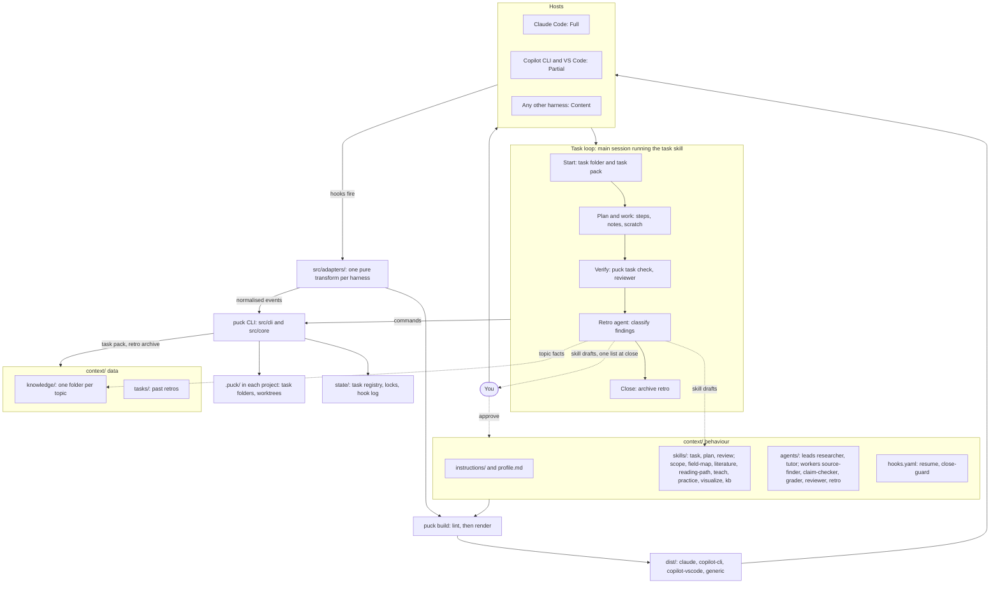

# Puck design

Puck is a layer in front of any agent harness. It optimises the context an LLM gets and improves its tools, for two jobs: coding and planning systems, and learning topics. Claude Code and Copilot are the first adapters, not the scope.

The evidence is in `docs/research/`. What has actually run on each host is in `docs/spikes.md`.

## Main concepts

**A layer, not an agent loop.** Skills, tools and instruction files travel between hosts. Loops, UIs, auth and sandboxes are expensive to rebuild and already good. Puck adds what hosts lack: plans that survive compaction, verification, and capture of what each task teaches. The cost is that it can only influence the loop, caching and compaction through hooks, and that reach varies by host.

**No model proxy.** Extension points can add context but can't trim what the harness sends. A proxy could, but it limits Puck to API-key use, so one gets added only if measured context use justifies it.

**History belongs to the host.** Puck keeps no session records. It tracks plans and their steps, and hooks restore a plan from the working directory.

**`context/` is the source of truth.** Behaviour (instructions, skills, agents, hooks, profile) is linted and built into per-host packages. Data (knowledge, past retros) only informs a task when it's read.

**Adapters keep hosts apart.** `src/core` knows no harness by name. Each harness gets one pure adapter that renders `context/` at build time and translates hook traffic at run time. The base `Adapter` is the generic harness, so anything reading `AGENTS.md` and `.agents/skills/` works without new code.

| Host | Tier | Status |
|---|---|---|
| Claude Code | Full | Tested in real sessions, including compaction and parallel tasks |
| Copilot CLI | Partial | Built, not yet run. No post-compact event, so it relies on the always-on rule to run `puck task show` |
| Copilot in VS Code | Partial | Built, not yet run. Its hooks are in Preview and ignore matchers |
| Any other harness | Content | Skills and instructions only, with no hooks |

**Primitives.** Ask these in order, and the first yes wins.

| Question | Primitive |
|---|---|
| Must it happen every time, whatever the model decides? | Hook |
| Can a program compute it exactly? | CLI command or skill script |
| Is it a short rule true in nearly every session? | Instruction |
| Is it a repeatable procedure needed only sometimes? | Skill |
| Is it noisy, or does it need fresh eyes or fewer tools? | Agent |
| Is it a fact needed only for one procedure? | Skill `references/` |
| Is it study material? | Knowledge |
| Does it only matter to this task? | Task file, or scratch for experiments |

**Context tiers.** The host owns the window. Puck owns what enters it and what survives it.

| Tier | Contents | Budget | Loaded by |
|---|---|---|---|
| Always-on | `instructions/global.md`, `profile.md` | 6,000 characters | `resume` hook, or `AGENTS.md` on the generic harness |
| Listings | Skill and agent descriptions | 1,024 characters each | Host |
| Injected | Open plan checklist | 10,000 characters per hook payload | `resume` hook, at session start and after compaction |
| On-demand | Skill bodies, references, wiki pages | Read only when needed | The agent |
| Task state | `SPEC.md`, `progress.json`, findings, scratch log | Pointer until needed | The agent |

**Task loop.** The main session follows the `task` skill and owns the whole workflow. Quick questions and one-line fixes don't open a task.

1. **Start.** `puck task start` opens a task folder and prints a task pack: paths and one-line summaries of relevant skills, wiki pages and past retros, capped at 2,000 characters.
2. **Plan.** The agent fills in `SPEC.md` and adds steps, each with a check command.
3. **Work.** Findings go through `puck note`, and uncertain ideas are tried in scratch.
4. **Verify.** `puck task check` runs each check, and only a real exit 0 passes a step. Non-trivial changes also get the `reviewer` agent.
5. **Retro.** With findings, a fresh `retro` agent classifies them, and `puck task close` refuses to finish without its output.
6. **Close.** The retro is archived, and any skill drafts go to you as one short list. If the agent forgets to close, the `close-guard` hook blocks once to remind it.

**Capture.** Risk decides how each finding lands. Standing instructions never change without your approval.

| Finding | Destination | How it lands |
|---|---|---|
| One-off | Task retro | Automatic |
| Fact about a topic | `knowledge/` wiki page with its source | Automatic |
| New procedure | Skill with status `draft`, which no build includes | Draft is automatic; promotion needs approval, then runs lint, evals, build and commit |
| Change to a skill | A diff in the task's `scratch/drafts/` | Approval, then `git apply` and build |

Instructions and project `AGENTS.md` files are never changed by the retro. They change rarely, so you edit them yourself.

**Parallel work.** The host runs the agents, and Puck keeps them from colliding. There's no global active task: hooks and commands find the plan from the working directory, so each worktree from `puck task start --worktree` sees only its own. Shared writes go through file locks. Merging stays your decision.

**Research and learning.** Each topic gets a folder in `context/knowledge/<topic>/`, which holds its state on every host. Skills cover the steps that need the user: `scope`, `field-map`, `literature`, `reading-path`, `teach`, `practice`, `visualize` and `kb`. Two lead agents, `researcher` and `tutor`, are what you talk to: each runs those skills in order. Worker agents cover one-shot jobs that need fresh eyes or parallel runs: `source-finder`, `claim-checker` and `grader`. Every harness gets leads as role skills, since a harness agent can't hold a conversation. Commands cover anything a program can do exactly:
- `puck sources` searches OpenAlex, Semantic Scholar, arXiv and Open Library, walks citation graphs, and checks quotes against saved text.
- `puck topic check` fails any wiki claim that doesn't trace to a source, and any source that doesn't resolve.
- `puck learn next` picks the next concept by its prerequisites.
- `puck learn check` runs an exercise's tests.

There is no teacher agent. Teaching is a conversation, and a subagent can't hold one, so the main session runs `teach`.

| The user wants to… | Skills, in order |
|---|---|
| Research a field | `scope` → `field-map` → `literature` → `reading-path`, as one task of type `research` |
| Study it | `teach`, calling `practice` and `visualize`; no task, since the topic folder holds the state |
| File a source, or ask the notes | `kb` |

Concept statuses are `unseen`, `introduced`, `practised`, `recalled-later` and `can-explain`. They record what happened, so none can be read as mastery.

**Not built yet:** spaced repetition with py-fsrs (next), paid search APIs, an MCP server and cross-host memory.

## Architecture

Solid lines are build and runtime paths. Dotted lines are the capture loop.



## Folder structure

```
puck/
  AGENTS.md  README.md  pyproject.toml  uv.lock
  assets/              # logo
  context/             # source of truth for everything the LLM sees
    instructions/      # global.md, the always-on rules
    profile.md         # hand-written facts about you
    skills/            # each has SKILL.md and evals/
    agents/            # leads: researcher, tutor; workers: source-finder, claim-checker, grader, reviewer, retro
    hooks.yaml         # resume, close-guard
    templates/         # SPEC, skill, agent, retro; mission, map, path, session
    knowledge/<topic>/ # mission, map, path, sources.json, raw/, wiki/, sessions/, exercises/, visuals/
    tasks/             # archived retros; created at first close
  docs/
    design.md          # this file
    features.md        # every skill, agent, command and hook
    spikes.md          # what's been tested on each host
    research/          # evidence behind the design
  src/
    core/              # harness-neutral, layered: each part imports only the ones above it
      common/          # model, paths, store, errors
      primitives/      # build, lint, skills: context/ into host packages
      tools/work/      # tasks, pack, scratch: the task loop
      tools/learning/  # topics, kb, exercises, sources/: research and study
      hooks.py         # hook entry point and handlers
    adapters/          # base.py is the generic harness; claude.py, copilot.py
    cli/               # main.py dispatches; commands/ mirrors core
  tests/               # with fixtures/ and golden/
  dist/                # generated per-host packages, gitignored
  state/               # task registry, locks, hook log, gitignored; also holds
                       # task folders for work outside a git repository

<project>/.puck/       # excluded through .git/info/exclude
  tasks/<id>/
    SPEC.md            # goal, decisions, non-goals, acceptance checks
    progress.json      # machine-updated step state
    findings.md        # appended by puck note
    retro.md           # written at close, copied to context/tasks/
    scratch/           # LOG.md, experiments/, drafts/, outputs/
  worktrees/<id>/      # created by puck task start --worktree
```
